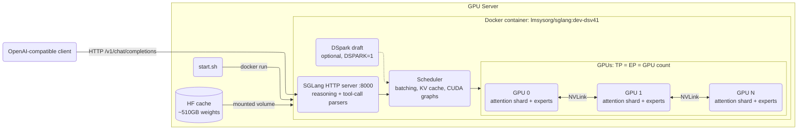

# DeepSeek-V4.1-Flash on SGLang

One-command SGLang deployment of [deepseek-ai/DeepSeek-V4.1-Flash](https://huggingface.co/deepseek-ai/DeepSeek-V4.1-Flash), serving an OpenAI-compatible API.

Recipe: [SGLang cookbook, DeepSeek-V4.1](https://docs.sglang.io/cookbook/autoregressive/DeepSeek/DeepSeek-V4_1) (H200 cell, the verified one). GPUs with more memory than H200 (B200, B300, ...) are auto-detected and get a relaxed config.

## Architecture



`start.sh` sizes the config from the GPU memory it finds (see [Parallelism](#parallelism)) and launches one SGLang container. Weights (fp8 dense + fp4 experts) are downloaded once into the mounted Hugging Face cache. Attention is tensor-parallel and the MoE experts are expert-parallel across the same GPUs. Each request goes through the scheduler, which batches it with others, and the reply comes back through the API server. The server splits thinking into `reasoning_content` and parses tool calls.

## Server Deployment

Requires Docker + NVIDIA Container Toolkit on the server.

```bash
./install_docker.sh   # one-time; skips anything already installed
cp .env.sample .env   # optional; edit overrides
./start.sh            # streams the boot log, returns once /v1/models answers
./stop.sh
```

First boot downloads ~510GB of weights into `~/.cache/huggingface` (override with `HF_CACHE`).

### Parallelism

TP = EP = number of GPUs in `GPU_ID` (2, 4 or 8). `start.sh` reads per-GPU memory from `nvidia-smi` (override with `GPU_MEM_GB`, in GiB) and picks a profile:

| Per-GPU memory | Profile |
|---|---|
| < 160 GiB (H200) | Cookbook pins `--attention-backend dsv4`, `--moe-runner-backend flashinfer_mxfp4`, `--cuda-graph-max-bs-decode 64`; `MEM_FRACTION` 0.8 |
| >= 160 GiB (B200, B300, ...) | Pins dropped so SGLang resolves backends and the decode graph list itself; `MEM_FRACTION` 0.9. Untested on these GPUs: check the startup log for the resolved backends |

| Total memory (GPUs x per-GPU) | Status |
|---|---|
| >= 600 GiB (8x H200, 4x B200/B300) | Full window, no caps |
| 500-600 GiB (4x H200, 2x B300) | Tight vs ~510GB weights; defaults to `MEM_FRACTION` 0.92 plus `--max-running-requests 16 --chunked-prefill-size 1024 --context-length ${CONTEXT_LENGTH}` (default 65536; override via `CONTEXT_LENGTH` or `EXTRA_ARGS`) |
| < 500 GiB (2x H200) | Rejected: can't hold the weights |

### Settings (`.env` or shell env)

| Variable | Default | Description |
|----------|---------|-------------|
| `GPU_ID` | `0,1,2,3,4,5,6,7` | GPUs passed to the container (2, 4 or 8; see Parallelism) |
| `GPU_MEM_GB` | auto (`nvidia-smi`) | Per-GPU memory in GiB; picks the H200 vs larger-GPU profile |
| `HOST` / `PORT` | `0.0.0.0` / `8000` | API bind address |
| `IMAGE` | `lmsysorg/sglang:dev-dsv41` | Preview build; V4.1 is not in an SGLang release yet |
| `MEM_FRACTION` | `0.8` (< 160 GiB GPUs) / `0.9` (>= 160 GiB) / `0.92` (tight) | `--mem-fraction-static` |
| `THINKING` | `0` | `1` = think by default (`SGLANG_DEFAULT_THINKING`) |
| `CONTEXT_LENGTH` | `65536` | Tight configs only: `--context-length` cap (otherwise the model window) |
| `DSPARK` | `0` | `1` = DSpark speculative decoding (bundled draft, block size 5) |
| `HF_CACHE` | `~/.cache/huggingface` | Host model cache |
| `HF_TOKEN` | unset | Optional (public model) |
| `EXTRA_ARGS` | unset | Extra SGLang flags, appended last |

Thinking is off by default. Send `reasoning_effort` (`low`, `high`, `xhigh`, `max`) in the request to turn it on, or set `THINKING=1`. `--reasoning-parser auto` puts the thinking in `reasoning_content`. Tool calling uses `--tool-call-parser auto` (resolves to `deepseekv41`). Send `tools` in the request; no extra flag is needed.

On H200 the cookbook pins `--attention-backend dsv4`, `--moe-runner-backend flashinfer_mxfp4` and `--cuda-graph-max-bs-decode 64`, because the default decode CUDA-graph batch list does not fit in 140 GiB. For the high-throughput variant, add `EXTRA_ARGS="--max-running-requests 256"`.

DSpark (`DSPARK=1`): the cookbook's low-latency cells on other GPUs turn it on, but the verified H200 cells run without it. It is untested here, so it is off by default.

## Test

```bash
curl http://localhost:8000/v1/chat/completions -H "Content-Type: application/json" \
  -d '{"model": "DeepSeek-V4.1-Flash", "messages": [{"role": "user", "content": "Who won the world series in 2020?"}]}'
```

## Files

- `install_docker.sh`: installs Docker + NVIDIA Container Toolkit (on the GPU host)
- `start.sh` / `stop.sh`: run and stop the SGLang server (on the GPU host)
- `.env.sample`: optional overrides for `start.sh`
