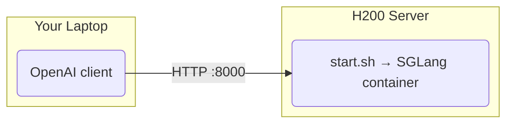

# DeepSeek-V4.1-Flash on SGLang (8x H200)

One-command SGLang deployment of [deepseek-ai/DeepSeek-V4.1-Flash](https://huggingface.co/deepseek-ai/DeepSeek-V4.1-Flash), serving an OpenAI-compatible API.

Recipe: [SGLang cookbook, DeepSeek-V4.1](https://docs.sglang.io/cookbook/autoregressive/DeepSeek/DeepSeek-V4_1) (H200 cell).

## Architecture



## Server Deployment

Requires Docker + NVIDIA Container Toolkit on the server.

```bash
./install_docker.sh   # one-time; skips anything already installed
cp .env.sample .env   # optional; edit overrides
./start.sh            # streams the boot log, returns once /v1/models answers
./stop.sh
```

First boot downloads ~510GB of weights into `~/.cache/huggingface` (override with `HF_CACHE`).

### Parallelism

TP8 + EP8 on all 8 GPUs, the only H200 recipe. `GPU_ID` must list 8 GPUs; 4x H200 (~564GB) can't fit the ~510GB weights plus KV cache.

### Settings (`.env` or shell env)

| Variable | Default | Description |
|----------|---------|-------------|
| `GPU_ID` | `0,1,2,3,4,5,6,7` | GPUs passed to the container (must be 8) |
| `HOST` / `PORT` | `0.0.0.0` / `8000` | API bind address |
| `IMAGE` | `lmsysorg/sglang:dev-dsv41` | Preview build; V4.1 is not in an SGLang release yet |
| `MEM_FRACTION` | `0.8` | `--mem-fraction-static` |
| `THINKING` | `0` | `1` = think by default (`SGLANG_DEFAULT_THINKING`) |
| `DSPARK` | `0` | `1` = DSpark speculative decoding (bundled draft, block size 5) |
| `HF_CACHE` | `~/.cache/huggingface` | Host model cache |
| `HF_TOKEN` | unset | Optional (public model) |
| `EXTRA_ARGS` | unset | Extra SGLang flags, appended last |

Thinking is off by default. Send `reasoning_effort` (`low`, `high`, `xhigh`, `max`) in the request to turn it on, or set `THINKING=1`. `--reasoning-parser auto` puts the thinking in `reasoning_content`. Tool calling uses `--tool-call-parser auto` (resolves to `deepseekv41`). Send `tools` in the request; no extra flag is needed.

The cookbook pins `--attention-backend dsv4`, `--moe-runner-backend flashinfer_mxfp4` and `--cuda-graph-max-bs-decode 64` on H200, because the default decode CUDA-graph batch list does not fit in 140 GiB. For the high-throughput variant, add `EXTRA_ARGS="--max-running-requests 256"`.

DSpark (`DSPARK=1`): the cookbook's low-latency cells on other GPUs turn it on, but the verified H200 cells run without it. It is untested here, so it is off by default.

## Test

```bash
curl http://localhost:8000/v1/chat/completions -H "Content-Type: application/json" \
  -d '{"model": "DeepSeek-V4.1-Flash", "messages": [{"role": "user", "content": "Who won the world series in 2020?"}]}'
```

## Files

- `install_docker.sh`: installs Docker + NVIDIA Container Toolkit (on the H200 host)
- `start.sh` / `stop.sh`: run and stop the SGLang server (on the H200 host)
- `.env.sample`: optional overrides for `start.sh`
